# Real-time Software Rasterizer based on CPU Simulation

### Introduction

The Real-time Software Rasterizer is developed using C++ and implements the basic flow of the rasterization rendering pipeline (Vertex Assembly -> Vertex Shader -> Primitive Assembly -> Rasterization -> Fragment Shader). Based on the graphics theory from games101 and games202, it implements **Orthographic/Perspective Projection**, **Attribute Interpolation and Perspective Correcting**, **Depth Testing**, **Blinn-Phong Lighting Model**, **Normal/Bump/Displacement Mapping**, **Two-pass Shadow Map Hard/Soft Shadows** (Hard, PCF, PCSS), **Deferred Rendering**, **Screen Space Ambient Occlusion (SSAO)**, **Screen Space Direct Occlusion (SSDO)**, and **Screen Space Reflections (SSR) with its acceleration structure** (Depth-Mipmap). This renderer does not currently use pre-computation methods and supports dynamic light sources and dynamic scenes; light positions, object positions, and camera poses can be changed in real-time via keyboard and mouse input. Openrenderer is created for the purpose of learning and understanding the hardware rendering pipeline; the project still needs further refinement and will be updated continuously.

### Quick Start
- [bilibili video](https://www.bilibili.com/video/BV1vwYdeREEG/?share_source=copy_web&vd_source=75e3a4981c5fa5c18f79deefa32fb7df)

- Test Environment

```
CPU: AMD R5-4800H

OS: Windows11/Ubuntu2204

Compiler: MinGW-w64(gcc/g++), MSVC, Clang
```

- Compilation

```
git clone https://gitee.com/xingheguntangxi/openrenderer.git
cd openrenderer
mkdir build && cd build
cmake ..
cmake --build . -j
```

- Running

The compiled executable is located in the `build/bin/` directory; please note to change file paths before running. This project uses `.json` configuration files to load model scenes; Marry scene and cornellbox scene are provided in advance.

### Effects

- Two-pass rendering light-view depth map

<div align=center>
	
    
</div>


- Deferred rendering gbuffer (position+depth+normal+albedo)
  <div align=center>
  	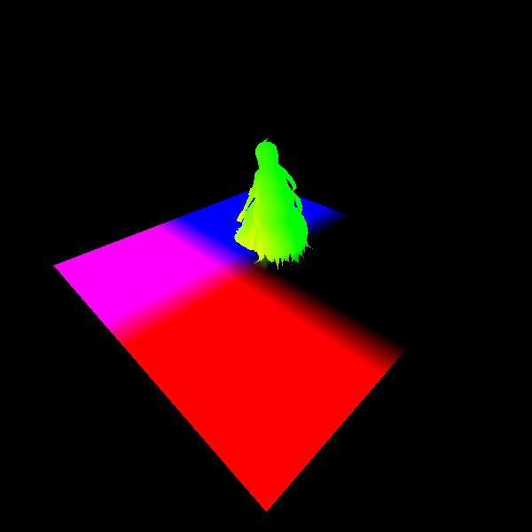
  	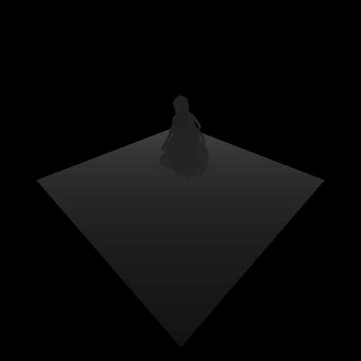
      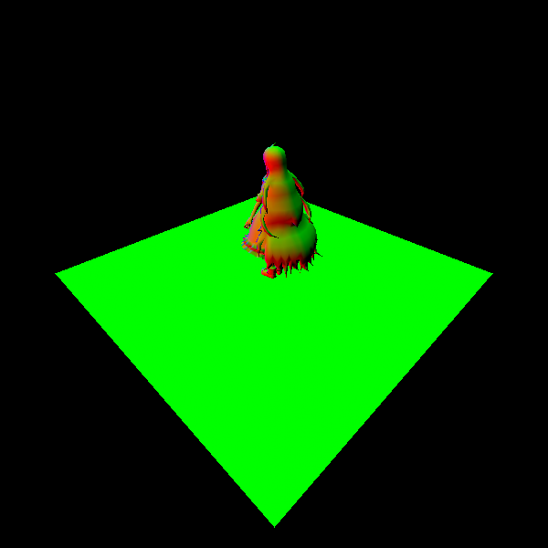
      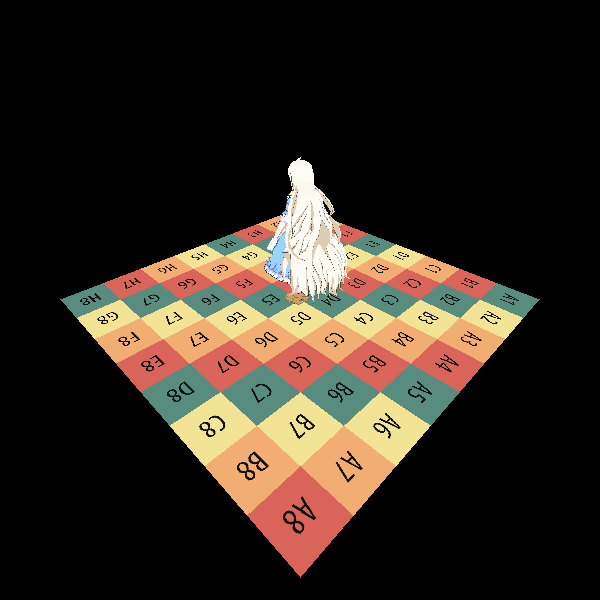
  </div>
  
  <div align=center>
    	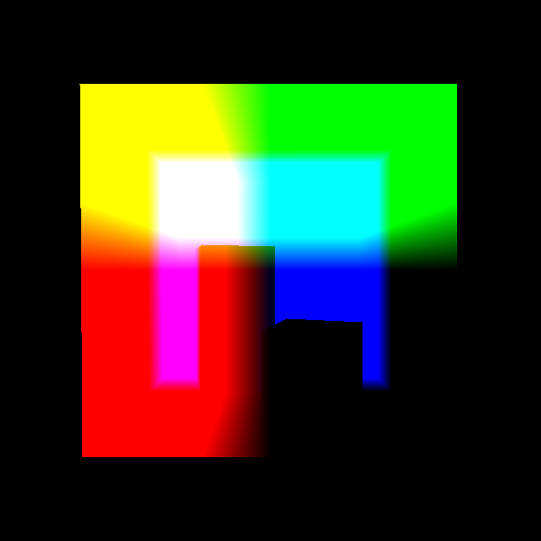
    	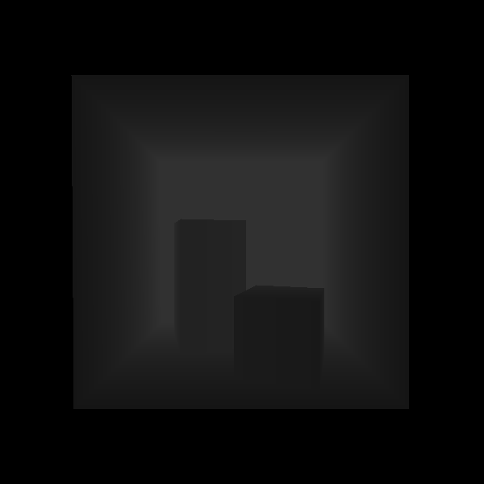
    	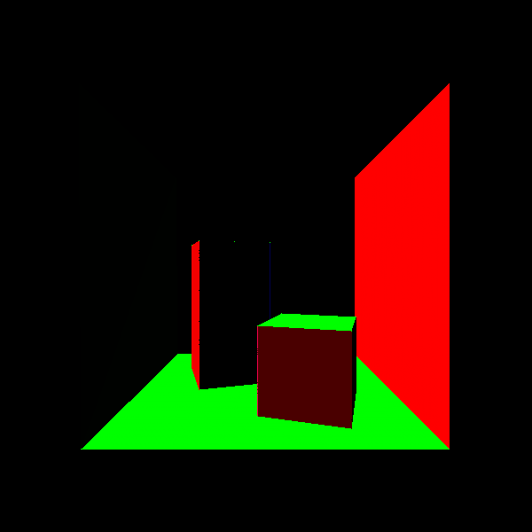
    	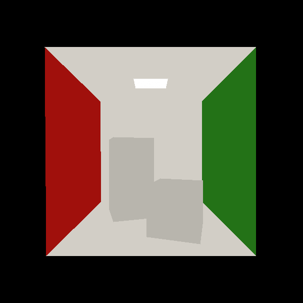
  </div>
- shadowmap (Hard+PCF+PCSS)

<div align=center>
	
	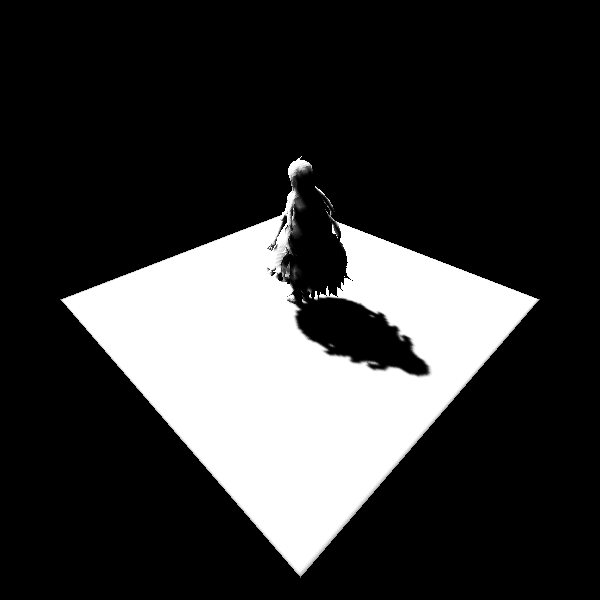
    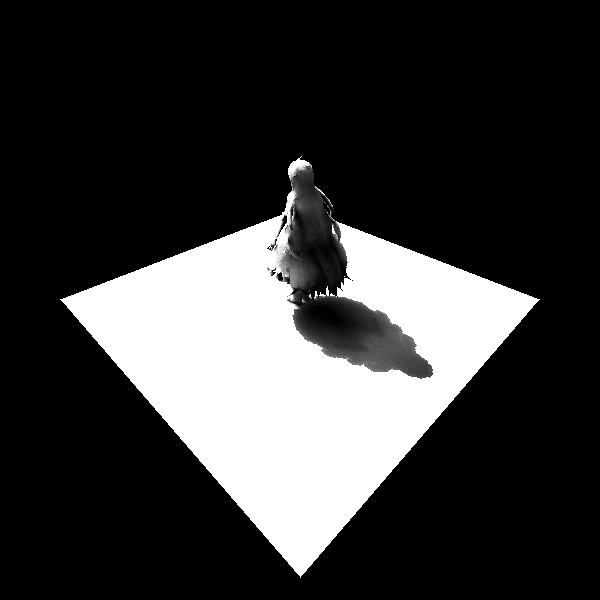
</div>


- SSR acceleration structure: min-depth mipmap

<div align=center>
	
	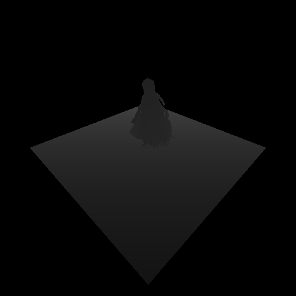
    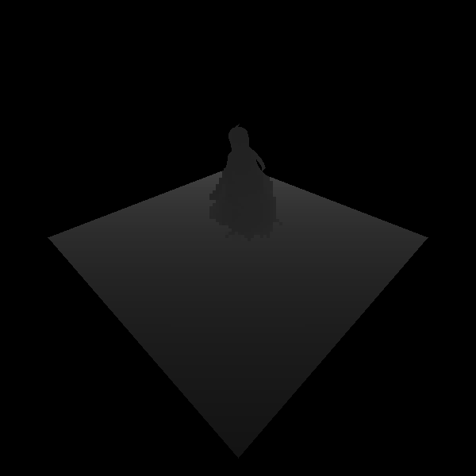
    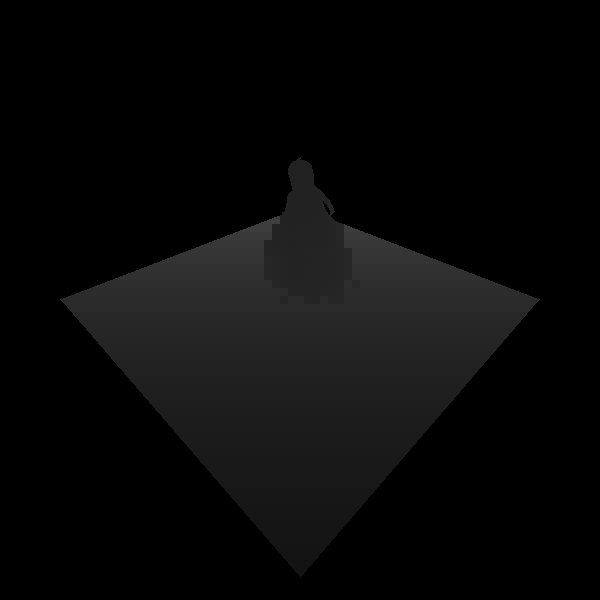
	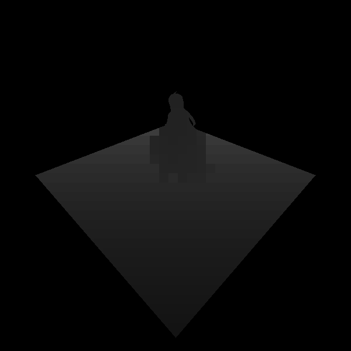
    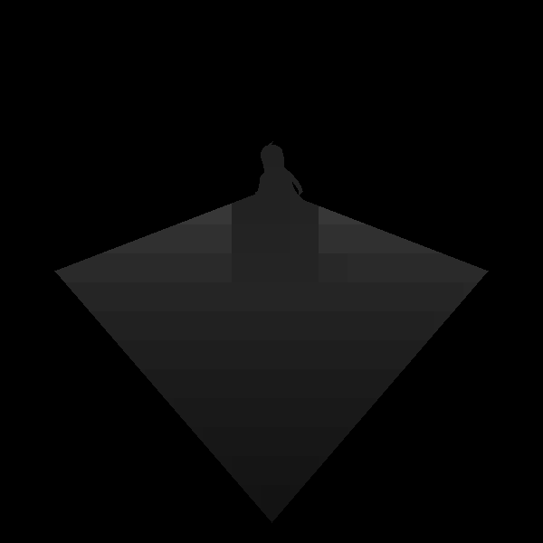
</div>


- Screen Space Global Illumination (SSAO+SSDO+SSR)

<div align=center>
	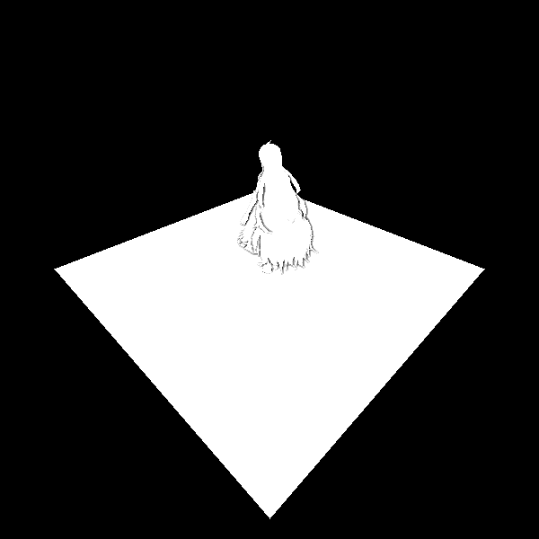
	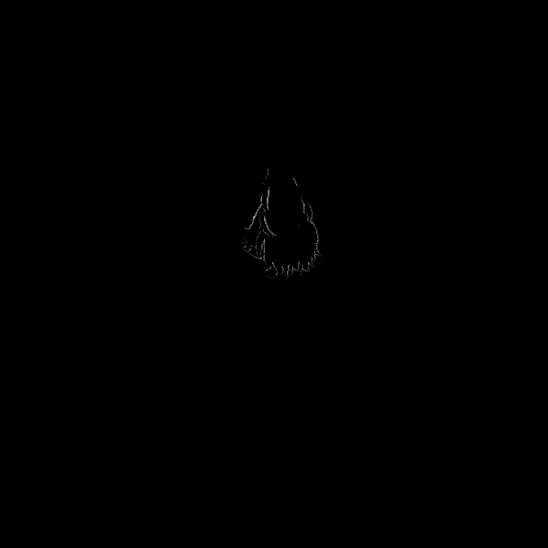
    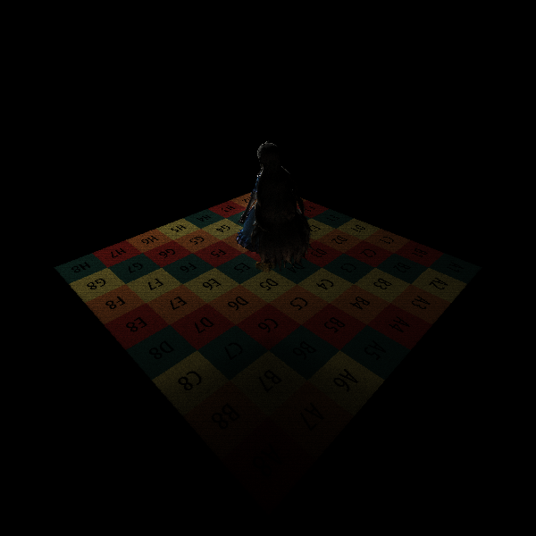
</div>

<div align=center>
	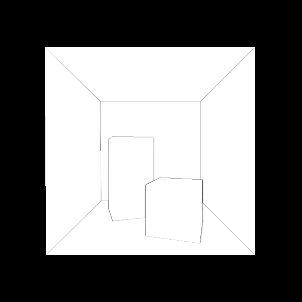
	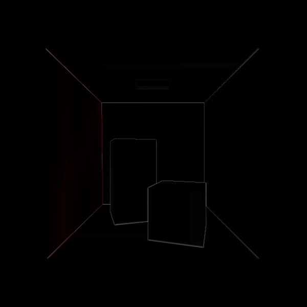
    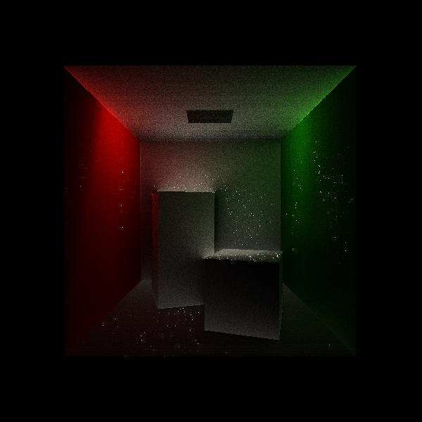
</div>


- Normal/Bump Mapping

<div align=center>
	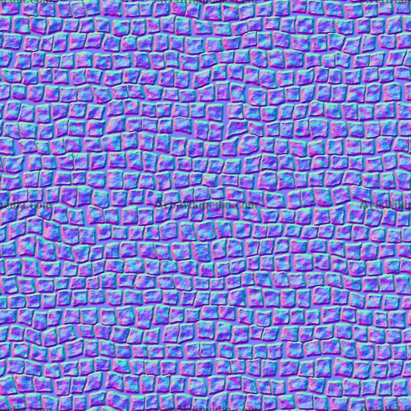
	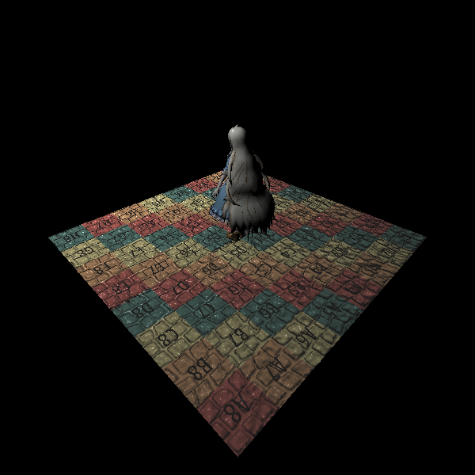
    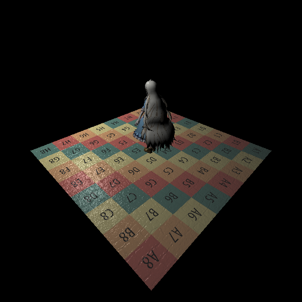
</div>

<div align=center>
	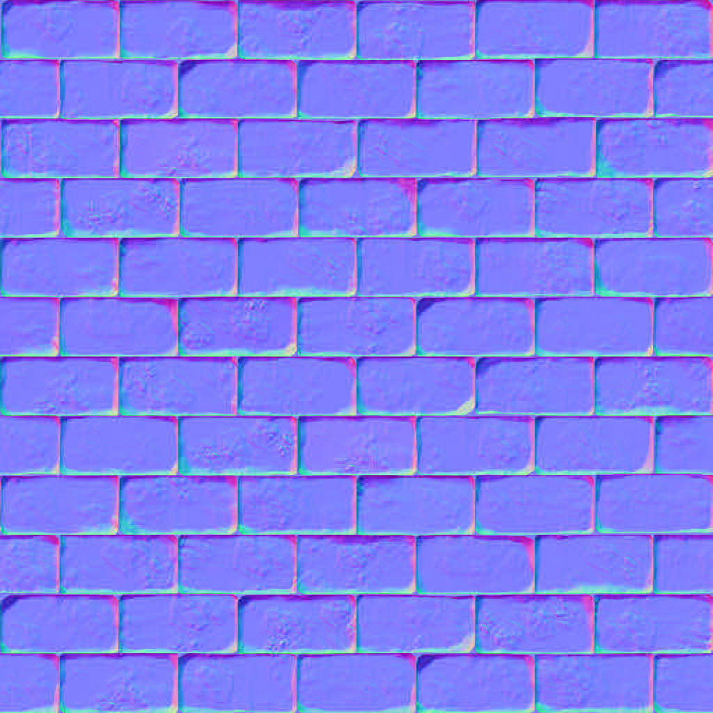
	
    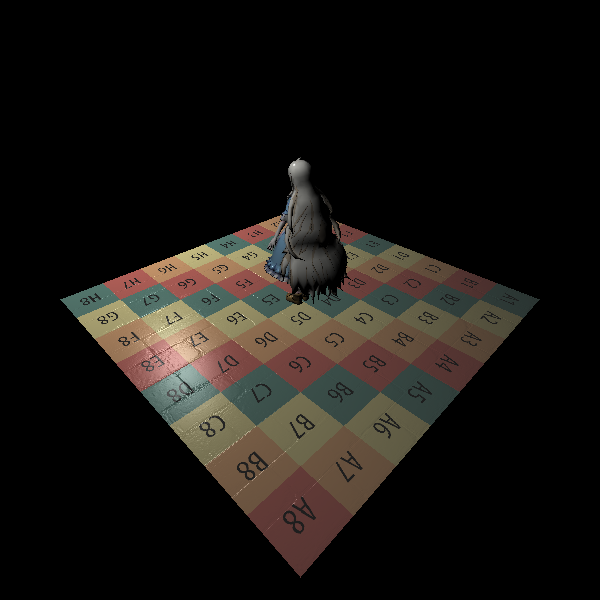
</div>


### Real-time Rendering

#### Basic Blinn-Phong Model


#### All Effects Enabled (PCSS Soft Shadows, SSAO, SSDO)


#### Screen Space Ray Tracing

- Samples = 1


- Samples = 4


- Samples = 16


